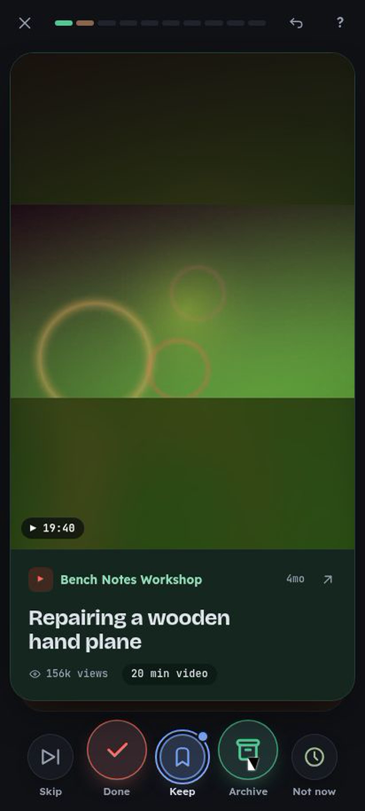

# content-hoarder

**A triage tool for your saved-content backlog.** Reddit saves, YouTube playlists, Hacker News
favorites, browser tabs, Obsidian/Keep notes and Twitter/X bookmarks go into one local SQLite
library; then you clear it a few cards at a time — *Done*, *Archive*, *Keep* or *Not now* — with
undo on everything.

It is built for the shape of an ADHD backlog: you over-save, the pile becomes debt, and reading all
of it is never going to happen. So the product is not a prettier hoarding machine. The core thesis
is **process and reduce, not just aggregate**: a five-minute round, a reversible "let this pile go",
and a library that is smaller and calmer when you stop.



Status: local release (source `VERSION` is `1.0.0`; unreleased work ships from `main`). The v3
browse UI, offline PWA shell, Reddit OAuth/sync, inline reader, recovery tooling, media archiving,
Obsidian export and optional local-LLM assist are in. Release notes: [`CHANGELOG.md`](CHANGELOG.md).

## Try it

- **Hosted demo:** <https://demo.khaosapp.tech> — an invite-only pilot. It runs the same app with
  one separate library per tester; ask for an invite link.
- **Local demo, synthetic data:** `./scripts/demo.sh` creates a temporary library of invented
  saves and serves it on <http://127.0.0.1:8791/>. See the [visitor walkthrough](docs/DEMO.md).

### Local quickstart

Install [Bun](https://bun.sh) 1.4 or newer, then:

```bash
bun install --frozen-lockfile
bun run src/cli.ts --version
bun run src/cli.ts init-db
bun run src/cli.ts import <path>   # a file or directory; detects the source
bun run start                      # http://127.0.0.1:8788
```

The default database path is `data/app.db` under the current working directory. Set
`CONTENT_HOARDER_DB` to use a different path. The CLI loads `.env` from the working directory;
existing shell environment values take precedence.

Native media tools are optional and only needed by their corresponding commands: `ffmpeg` for
video/HLS work, `tesseract` for OCR, and ImageMagick `magick` for image preparation. No server,
scheduler, OAuth flow, sync, or archive operation runs during installation or startup.

### Serve from anywhere

Set `CONTENT_HOARDER_DB` to an explicit database path and run the entry point from this checkout:

```bash
CONTENT_HOARDER_DB=/path/to/app.db bun run /path/to/content-hoarder/src/cli.ts serve
```

The web server binds to `127.0.0.1:8788` by default. Use `--host` only on a trusted private
network; never expose this personal-data application to the public internet.

## What it does

- Unified import from Reddit, YouTube playlists, Hacker News, Obsidian vaults, Google Keep,
  **Firefox tabs**, and browser-exported Twitter/X bookmarks into one local SQLite database.
- Full-text **and** fuzzy (typo-tolerant) search, with discoverable Gmail/Discord-style **operators**
  (`source:`, `tag:`, `status:`, `is:swept`, `has:video`, `before:`, `score:>100`, `"exact"`, `-exclude`)
  surfaced by an autocomplete popover, plus a **shuffle/mix** browse mode that interleaves sources.
- A triage UI with two modes: a one-at-a-time **swipe/keyboard card** mode and a **list** view with
  bulk keep/archive actions, Gmail-style swipe icons, source tabs + a status sidebar, and an undo snackbar.
- **Processing areas:** heuristic categorization of videos into *listenable* / *watch* / *wotagei*
  (no LLM), filterable in the inbox; correct a tag from the triage card.
- **Reddit in the Library:** filter your unified library to Reddit saves and open items in the
  inline reader. `/reddit` redirects to the Reddit-filtered Library.
- **Content recovery (non-destructive):** restore `[removed]`/`[deleted]` Reddit posts/comments (and
  un-hydrated saved comments) from PullPush/Arctic-Shift, and `[Private/Deleted video]` YouTube titles
  from the Wayback Machine. The in-app **"↻ Recover text from archives"** button (`recover_one`) runs
  the metadata chain per-item only. Deleted reddit media byte recovery through **archive.today** is a
  separate explicit opt-in action/API mode for reddit images whose originals are already 404
  (`media_status='gone'`) — low hit rate, Cloudflare-gated, and never bulk.
- **Duplicate detection:** flag possible duplicates (by URL or title) and reversibly resolve them.
- Per-item status: `inbox` → `keep` / `archived` / `done`, with one-step undo and a reversible
  "content bankruptcy" bulk-archive.
- Responsive, installable **PWA** so you can triage on desktop or phone.
- Runs locally on Bun + TypeScript, with SQLite and native media/network integrations. Python and
  `yt-dlp` are not app runtime dependencies; `yt-dlp` is optional for preparing playlist exports.

## Privacy

- **The library is local.** Your items live in one SQLite file (`data/app.db` by default) with
  content-addressed media beside it. Your DB, media, exports, `.env` and NSFW list are gitignored,
  so they are never part of this repository.
- **This repository holds source and invented data.** Everything committed here is code, docs and
  small synthetic fixtures written for tests and demos — no user library, no account exports, no
  credentials.
- **What leaves the machine, and when.** Cards load thumbnails and media from the sites they were
  saved from. Opening a Reddit item in the reader fetches its comment thread (then public archives)
  unless it is cached. Sync, recovery, enrichment, hydration, unsave and promote are separate
  opt-in commands that talk to the services they name; nothing bulk-runs on startup.
  `CONTENT_HOARDER_OFFLINE=1` blocks the app's server-side outbound requests for demos and tests;
  browser-loaded external media and embeds can still contact their providers.
- **AI suggestions are off by default.** With per-library consent, the item's title, source and
  link go to the configured provider to get a hint.
- **Reddit writes need explicit consent.** Unsave-on-done is off by default; the live lane requires
  both `--live` and `--yes`.
- **The hosted demo** stores each tester's library in a separate file on one server, deletes a
  library on request, and records pilot interaction events inside that tester's own library (opt-in
  at deployment; `CONTENT_HOARDER_DEMO_ANALYTICS=1`).

To configure locally, copy `.env.example` → `.env` and (optionally)
`nsfw_rules.example.json` → `nsfw_rules.json`.

Publication policy and the check that runs before a public push:
[`docs/PUBLISH-SAFETY.md`](docs/PUBLISH-SAFETY.md).

## CLI reference

See the [CLI reference](docs/cli.md) for commands and Reddit hydration examples.

## Mobile access

The app is a responsive PWA you can install on **Chrome for Android** (browser menu → *Install app*,
which creates a real standalone WebAPK). Reach it from your phone over a private **Tailscale** tunnel or your
LAN. **Security warning: never expose this personal-data app to the public internet** — no port
forwarding; keep it strictly behind a VPN/Tailscale or a trusted LAN.

### Phone quickstart (Tailscale)
1. On the PC, find your Tailscale IP (`tailscale ip -4`, a `100.x.y.z` address) and start the app
   bound to it: `bun run src/cli.ts serve --host 100.x.y.z` (the web guard already accepts
   tailnet addresses; add real DNS names via `CONTENT_HOARDER_ALLOWED_HOSTS`).
2. On the phone (Tailscale connected), open `http://100.x.y.z:8788/` in Chrome.
3. Install it: Chrome menu (⋮) → **Install app** (a real WebAPK). The PWA opens fullscreen with the
   app icon; the service worker caches the shell, so cold opens are instant. *(Install needs a secure
   context — use the HTTPS `*.ts.net` URL from `tailscale serve`; see [docs/MOBILE_TAILSCALE.md](docs/MOBILE_TAILSCALE.md).)*
4. Notes for gesture navigation: row swipe is touch-only by design; if a fresh deploy looks stale,
   the shell cache updates on the next reload (the SW takes one visit to swap versions).

## Source notes & caveats

- **YouTube "Watch Later" cannot be exported** via the API or Google Takeout. Regular playlists
  (e.g. WL2, WL3) work via `yt-dlp --flat-playlist`; a Watch Later list can only be brought in from a
  manual/browser-extension export.
- **Hacker News**: favorite stories to your HN account (e.g. via the actively-maintained **Harmonic**
  app) and import your public `favorites?id=USER` page — server-side, no phone. *(Legacy: the abandoned
  **Materialistic** app stored saves **locally only**, needing an `adb backup` of its DB; see
  docs/IMPORTING.md.)*
- **Google Keep** is imported from an official **Google Takeout** export (one per account). The
  unofficial `gkeepapi` is intentionally **not** used (ToS / account-lockout risk).
- **Firefox tabs** are imported from the "Export Tabs URLs" extension's `.txt` (Rich format);
  YouTube tabs are promoted to canonical `youtube:<id>` rows.
- **Twitter/X bookmarks** are imported from a browser-side JSON/CSV export, not the paid API;
  rows are keyed as `twitter:<tweet_id>` and retain tweet text, author, permalink, outbound links,
  quote/reply context, and image/video media URLs. Re-importing overlapping daily exports de-dups by URL. Tweets that link to YouTube
  videos can be folded into canonical `youtube:<id>` rows with `consolidate`; imported tweet images
  and videos can be cached locally with `bun run src/cli.ts archive-media --twitter --apply`.

## Project tracking

Active work is tracked in [GitHub Issues](https://github.com/asmartin-ai/content-hoarder/issues).

## License

[MIT](LICENSE).
